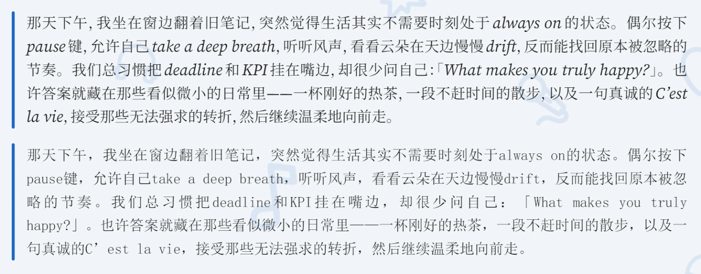
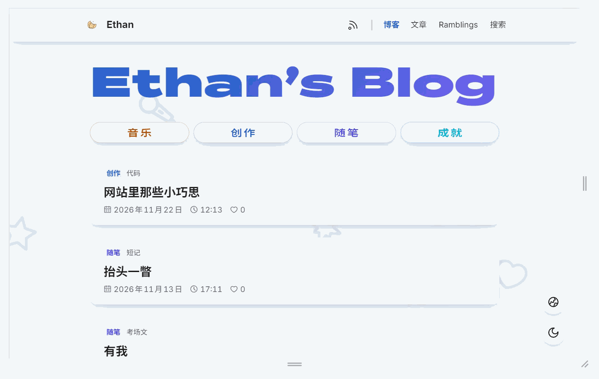
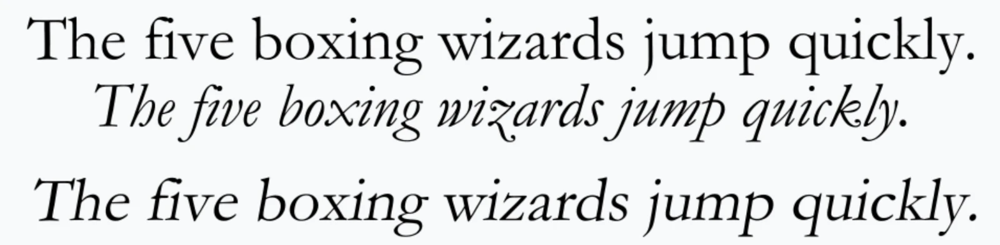
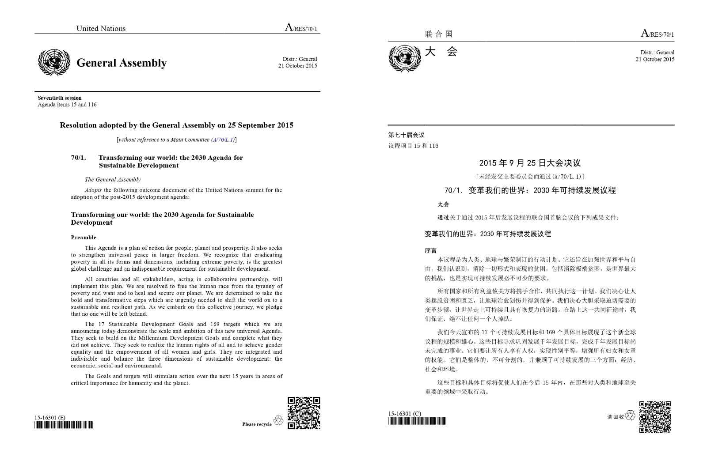

从网站的第一个版本上线到现在，已经差不多**半年**了！！！虽然说我这个网站好像也并没有多少访客...但是我确实花了不少的时间和精力啦~

我也希望大家在阅读文章的时候能够读得顺心，所以我在排版方面注入了**一万点**心思（不是  
不知道你发现没有✌️

## 字体

个人认为，字体对一个版面的美观度是起决定性作用的！！让我们尝试对比一下这两段文本：

*上：本站中文斜体的处理（思源宋体+Source Serif 4）；下：Windows宋体（中易宋体）*

孰优孰劣，大家自有公论。

> 如果你觉得第二段比较好，这只能说明你的审美比较...emm...**独特**。

所以我们选用了制作极其精良的**思源**系列字体作为中文主字体，**Inter**为英文主字体。同时，大家可以看到，在博客页面的主页、文章页、搜索页等页面上方会有一个冲击力极强的大标题，是用的可变字体**Google Sans Flex**，宽度、字重都可变，那个标题是可以根据设备的显示宽度自动调整的哦~

*动图：宽度可变的标题*

更多字体信息，参见[Info页面](https://www.ethan929.com/info)。

## 中西文之间，要加`空格`吗？

> 中西文之间**没有全国统一的强制性国家标准**，是否加空格取决于排版规范和写作场景：现代数字文案、技术文档和互联网写作中通常建议加一个半角空格，但在正式出版、学位论文或部分前端排版中则各有不同做法。　*——Gemini*

我一直都认为中西文之间是应存在间距的，只是添加间距的方式不同。本站建立初期，选择采用手动加入空格的方式进行排版。如：

> Apple<mark> </mark>公司最近发布了新款<mark> </mark>iPhone。

但是我懒嘛（）搜索后发现CSS已经添加了对 `text-autospace` 的支持，没有必要再打空格啦！不过在测试过程中也出现过一些问题，比如Safari中就出现过中西文没分开的情况。所以我动用钞能力哪来的钱命令DeepSeek严肃修复了这个问题🤓

对比：

> 开启 `text-autospace` ：Apple公司最近发布了新款iPhone。
>
> 关闭 `text-autospace` ：Apple公司最近发布了新款iPhone。

这一点空间，可以增加文本的呼吸感！~

## 中文…斜体？

> - **斜体**是在正常字体样式基础上，通过倾斜字体实现的一种字体样式；可指**意大利体**或**伪斜体**。
> - **意大利体**（Italic type）是一种手写体印刷字形。因为受到手写书法的影响，意大利体的字形微向右倾斜，其字母写法也接近于手写体，成为其主要特征。
> - **伪斜体**（oblique type）是西文字体的一种样式，是在正常字体样式基础上，通过机械地倾斜字体实现的一种字体样式。　*——Wikipedia*

{.img-md}
*正体（罗马体，Roman type）、真斜体（意大利体，Italic type）和伪斜体（oblique type）。 来源：维基共享资源*

由上述信息很容易明确：中文根本不存在真斜体。如果非要对应的话，按「手写体」的定义，最匹配的应该是楷体——联合国就是这么做的。

*中文楷体「大会/通过」对应英文斜体「The General Assembly / Adopts」。 来源：联合国大会A/RES/70/1*

但是我的正文是<ruby>无衬线体<rt>黑体</rt></ruby>，联合国的是<ruby>衬线体<rt>宋体</rt></ruby>，直接上楷体总归有点不协调。所以我给升了一级，改用了宋体，可以和黑体有很好的区分，也不会太突兀。中文页面的西文斜体，为了和宋体配套，用了衬线斜体——当然英文页面不会出现衬线体，所以还是无衬线体的斜体啦~

对比：

> *Apple公司最近发布了新款iPhone。*
>
> Apple recently released a new iPhone.

## 开明式标点

> **开明式标点**是一种中文出版排版风格，核心原则是句末点号占全宽，其余标点占半宽。它最早源于开明书店的出版物，与常见的所有标点均占一字宽的「全角式」相对。

鉴于「标点挤压」这一操作比较费时费力，一般只有专业排版软件才做得来；好在思源黑体本身就带半宽标点的字形，所以依旧动用钞能力又哪来的钱命令DeepSeek写了这套显示逻辑。

这个规则比较多，一句两句根本说不清。还是直接放篇选段吧：

> 这确是先前所没有料想到的。现在我已经记不清当时是怎样一个感想，但和猫的感情却终于没有融和；到了北京，还因为它伤害了兔的儿女们，便旧隙夹新嫌，使出更辣的辣手。「仇猫」的话柄，也从此传扬开来。然而在现在，这些早已是过去的事了，我已经改变态度，对猫颇为客气，倘其万不得已，则赶走而已，决不打伤它们，更何况杀害。这是我近几年的进步。经验既多，一旦大悟，知道猫的偷鱼肉，拖小鸡，深夜大叫，人们自然十之九是憎恶的，而这憎恶是在猫身上。假如我出而为人们驱除这憎恶，打伤或杀害了它，它便立刻变为可怜，那憎恶倒移在我身上了。所以，目下的办法，是凡遇猫们捣乱，至于有人讨厌时，我便站出去，在门口大声叱曰：「嘘！滚！」小小平静，即回书房，这样，就长保著御侮保家的资格。其实这方法，中国的官兵就常在实做的，他们总不肯扫清土匪或扑灭敌人，因为这么一来，就要不被重视，甚至于因失其用处而被裁汰。我想，如果能将这方法推广应用，我大概也总可望成为所谓「指导青年」的「前辈」的罢，但现下也还未决心实践，正在研究而且推敲。　*——鲁迅《朝花夕拾》（狗·猫·鼠）*

还算可以？🤓

## 引号

说起标点又不得不提引号这玩意了。。

### 直角引号 v.s. 弯引号

中文引号和西文引号 `“”` 其实用的是一样的码位 `U+2018, U+2019` ，主要是靠字体的设计来区分。而如果设计师考虑不周，就可能出现这种情况：

> That's great!

那对于这种情况，我们最简单的解决办法是什么呢？诶~那就是中文直接用直角引号 `「」` ，把英文字体留给弯引号！！这样一定会显示为正确的「That's great!」了！！🤓

### 智能弯引号

那么这时候就有朋友要问了：诶，英文中不是有直引号 `"` 吗？英文用这个，中文用弯引号不就得了？

的确是一种方案，但遗憾的是，直引号在英文排版中常被称为「**傻瓜引号**」（dumb quotes）...~~但我想证明我不傻~~。其实抛开这个不谈，即使采用这个方案，也得专门为弯引号做字体白名单。但是既然想证明自己不傻，我就再度动用钞能力又来是吧命令DeepSeek写了智能弯引号的逻辑。

调试了很长时间，现在基本可以完全正确匹配了。

比如：

- `I'm here!` -&gt; I'm here!
- `"I'm John," said he.` -&gt; "I'm John," said he.

甚至：

- `She said 'don't do it' and left.` -&gt; She said 'don't do it' and left.
- `''Cause I believe I love you.'` -&gt; ''Cause I believe I love you.'

*btw顺便拉踩一下 我用美式英语变相地避免了一些单引号成堆的问题（BrE lovers对不起对不起对不起）*

---

## Outro

怎么样——至少我自己觉得还可以啦~

网站时不时就会更一些神秘小文章，多来玩呀！