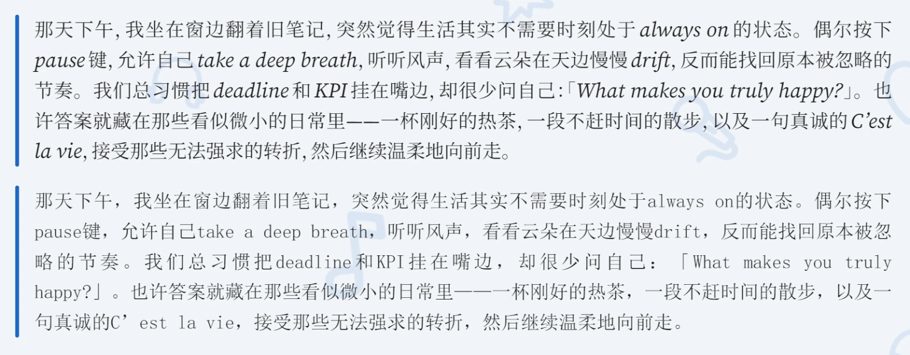
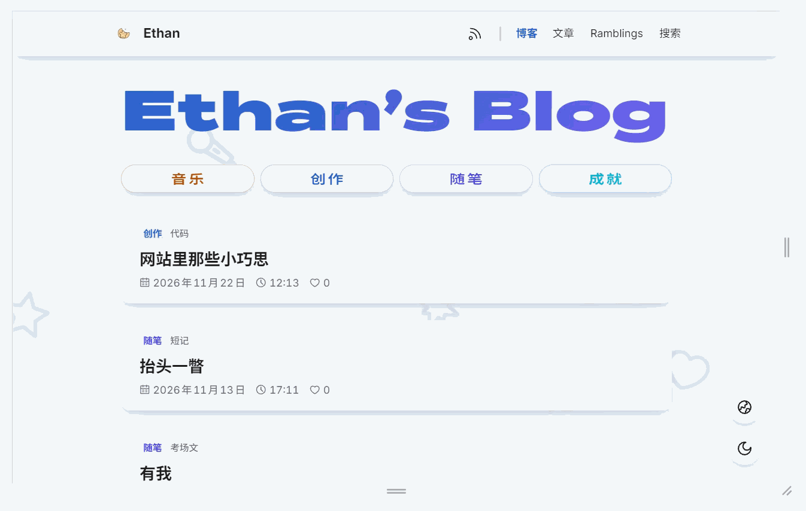
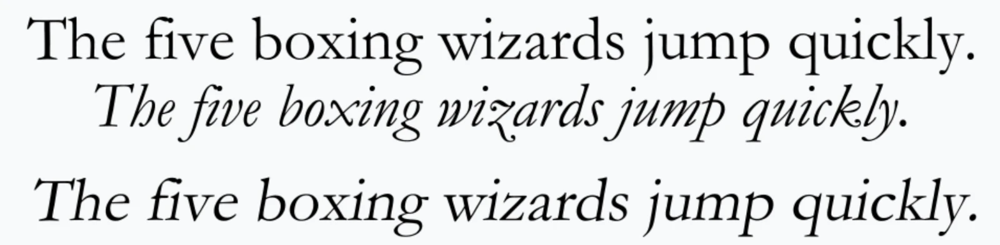
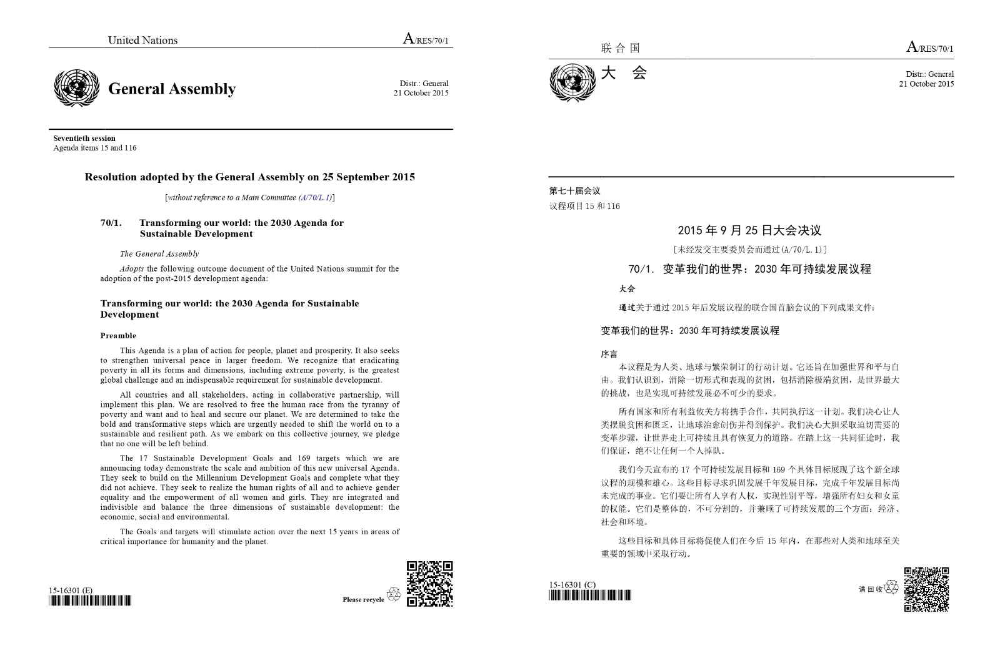

It's been almost **half a year** since the first version of this site went live!!! I know my site doesn't seem to get many visitors... but I really did pour a lot of time and effort into it~

I also want everyone to have a smooth, pleasant time reading the articles, so I put **billions of points** of thought into the typography (jk  
I wonder if you've noticed✌️

## Fonts

Personally, I think fonts play a decisive role in how good-looking a layout is!! Let's try comparing these two blocks of text:

*Top: how this site handles Chinese italics (Noto Serif CJK + Source Serif 4); bottom: Windows SimSun (ZhongYi Songti)*

Which is better is for everyone to judge for themselves.

> If you think the second one looks better, that only proves your taste is rather... emm... **unique**.

So we picked the exquisitely crafted **Noto CJK** *(aka **Source Han**)* family as the primary Chinese font, and **Inter** as the primary English font. Also, as you can see, at the top of the homepage, article pages, search page, and other pages of the blog there's a super punchy big headline, which uses the variable font **Google Sans Flex**—width and weight are both variable, and that headline automatically adjusts to your device's display width~

*GIF: the width-variable headline*

For more font info, see the [Info page](https://www.ethan929.com/info).

## Should there be a `space` between Chinese and Western text?

> There is **no unified mandatory national standard** for spacing between Chinese and Western text; whether to add a space depends on typographic conventions and the writing context: in modern digital copy, technical documentation, and internet writing, a half-width space is usually recommended, but in formal publishing, theses, or some front-end typesetting, practices vary.　*——Gemini*

I've always believed there should be spacing between Chinese and Western text—it's just that the way of adding it differs. In the early days of this site, I chose to add spaces manually for typesetting. Like:

> Apple<mark> </mark>公司最近发布了新款<mark> </mark>iPhone。

But I'm lazy () so after searching around I found that CSS already added support for `text-autospace`, so there's no need to type spaces anymore! That said, I ran into some issues during testing—for example, in Safari the Chinese and Western text sometimes didn't get separated. So I invoked my money powerwhere's the money coming from and ordered DeepSeek to seriously fix this problem🤓

Comparison:

> With `text-autospace` on: Apple公司最近发布了新款iPhone。
>
> With `text-autospace` off: Apple公司最近发布了新款iPhone。

That little bit of space adds some breathing room to the text!~

## Chinese... italics?

> - **斜体** *(Xiétǐ)* is a font style achieved by slanting the typeface on top of the normal font style; it can refer to **true italics** or **oblique type**. *(translated from Chinese Wikipedia)*
> - **Italic type** (or **italics**, plurale tantum) is a cursive font based on a stylised form of calligraphic handwriting. Owing to the influence from calligraphy, italics normally slant slightly to the right, *like so*. Different glyph shapes from roman type are usually used – another influence from calligraphy – and upper-case letters may have swashes, flourishes inspired by ornate calligraphy.
> - **Oblique type** is a form of type that slants slightly to the right, used for the same purposes as italic type. Unlike italic type, however, it does not use different glyph shapes; it uses the same glyphs as roman type, except slanted.　*——Wikipedia*

{.img-md}
*Roman type, Italic type and oblique type. Source: Wikimedia Commons*

From the above it's easy to establish: true italics simply don't exist in Chinese. If we must find an equivalent, by the definition of "handwritten style," the best match would be kaiti—and that's exactly what the United Nations does.

*Chinese kaiti "大会/通过" corresponds to English italics "The General Assembly / Adopts." Source: UN General Assembly A/RES/70/1*

But my body text is <ruby>sans-serif<rt>heiti</rt></ruby>, while the UN's is <ruby>serif<rt>songti</rt></ruby>, so going straight to kaiti would feel a bit out of place. So I bumped it up a level and switched to Noto Serif CJK, which distinguishes itself nicely from Noto Sans CJK without being too jarring. For Western italics on Chinese pages, to pair with the Serif, I used serif italics—of course, English pages never show serif fonts, so those are still sans-serif italics~

Comparison:

> Apple公司最近发布了新款iPhone。
>
> <i>Apple recently released a new iPhone.</i>

## Kaiming-style punctuation

> **Kaiming-style punctuation** is a Chinese publishing typographic style whose core principle is that sentence-ending punctuation takes full width while all other punctuation takes half width. It originated from publications of the Kaiming Bookstore, and stands in contrast to the common "full-width style" where all punctuation occupies one character width.

Given that "punctuation compression" is a rather time- and labor-intensive operation that generally only professional typesetting software can handle, fortunately Noto Sans CJK itself ships with half-width punctuation glyphs, so once again I invoked my money powerwhere's the money this time and ordered DeepSeek to write this display logic.

There are quite a lot of rules here—impossible to explain in a sentence or two. Better to just drop an excerpt (I recommend visiting the Chinese page to view the full Chinese layout):

> 这确是先前所没有料想到的。现在我已经记不清当时是怎样一个感想，但和猫的感情却终于没有融和；到了北京，还因为它伤害了兔的儿女们，便旧隙夹新嫌，使出更辣的辣手。「仇猫」的话柄，也从此传扬开来。然而在现在，这些早已是过去的事了，我已经改变态度，对猫颇为客气，倘其万不得已，则赶走而已，决不打伤它们，更何况杀害。这是我近几年的进步。经验既多，一旦大悟，知道猫的偷鱼肉，拖小鸡，深夜大叫，人们自然十之九是憎恶的，而这憎恶是在猫身上。假如我出而为人们驱除这憎恶，打伤或杀害了它，它便立刻变为可怜，那憎恶倒移在我身上了。所以，目下的办法，是凡遇猫们捣乱，至于有人讨厌时，我便站出去，在门口大声叱曰：「嘘！滚！」小小平静，即回书房，这样，就长保著御侮保家的资格。其实这方法，中国的官兵就常在实做的，他们总不肯扫清土匪或扑灭敌人，因为这么一来，就要不被重视，甚至于因失其用处而被裁汰。我想，如果能将这方法推广应用，我大概也总可望成为所谓「指导青年」的「前辈」的罢，但现下也还未决心实践，正在研究而且推敲。　*——**Dawn Blossoms Plucked at Dusk** (Dogs, Cats, and Mice) by Lu Xun*

Not bad, right?🤓

## Quotation marks

Speaking of punctuation, I can't not mention quotation marks..

### Corner brackets v.s. curly quotes

Chinese quotation marks and Western quotation marks `“”` actually use the same code points `U+2018, U+2019`—the distinction is mainly made through font design. And if the designer didn't think it through, you can end up with something like this:

> That's great!

So what's the simplest fix for this situation? Aha~ just use corner brackets `「」` for Chinese and leave the curly quotes to the English font!! That way it'll definitely display as the correct "That's great!"!!🤓

### Smart curly quotes

Now some friends will ask: hey, doesn't English have straight quotes `"`? Just use those for English and curly quotes for Chinese—problem solved, right?

That is indeed one approach, but unfortunately, straight quotes are often called "**dumb quotes**" in English typography... ~~but I want to prove I'm not dumb~~. Setting that aside, even with this approach you'd still have to build a special font whitelist for curly quotes. But since I want to prove I'm not dumb, I once again invoked my money powerhere we go again and ordered DeepSeek to write the smart curly quote logic.

After a long time debugging, it now basically matches perfectly.

For example:

- `I'm here!` -&gt; I'm here!
- `"I'm John," said he.` -&gt; "I'm John," said he.

Even:

- `She said 'don't do it' and left.` -&gt; She said 'don't do it' and left.
- `''Cause I believe I love you.'` -&gt; ''Cause I believe I love you.'

*btw while I'm at it, let me take a jab—by using American English I've indirectly dodged some of those pile-ups of single quotes (sorry sorry sorry to all BrE lovers)*

---

## Outro

So—at least I think it's pretty good~

The site gets some mysterious little articles added from time to time, so come by and hang out!